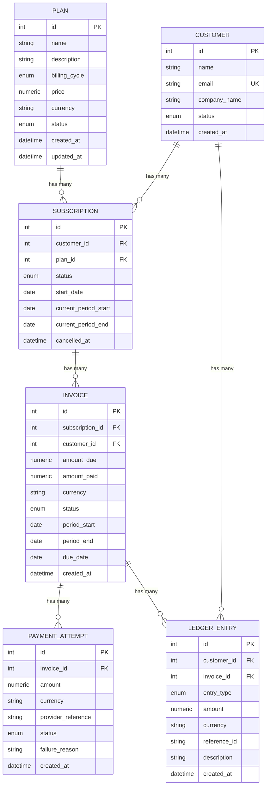
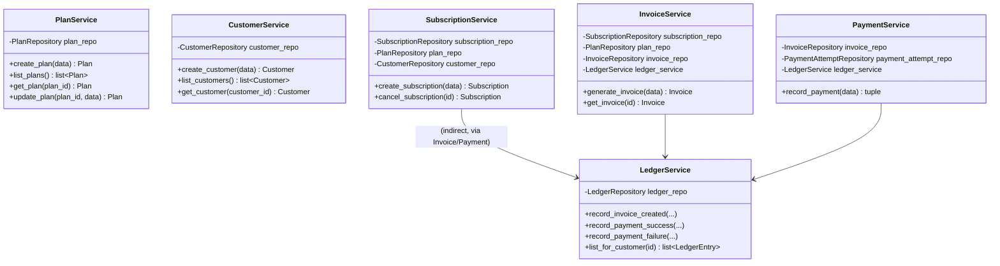

# SubLedger — Low-Level Design

## 1. Entity Relationship Diagram

## 2. Service responsibility table

| Service | Owns |
|---|---|
| `PlanService` | Validate price, billing cycle, and plan status changes |
| `CustomerService` | Create customers, enforce email uniqueness, fetch customer profile |
| `SubscriptionService` | Create/cancel subscriptions, check active plan, prevent duplicate active subscription |
| `InvoiceService` | Generate invoices, compute `amount_due` from the plan price at generation time |
| `PaymentService` | Record payment attempts, validate amount, trigger invoice status update + ledger entry |
| `LedgerService` | Create append-only ledger entries, fetch customer ledger history |

## 3. Repository responsibility table

| Repository | Entities it reads/writes | Common methods |
|---|---|---|
| `PlanRepository` | `Plan` | `get`, `list`, `add` (inherited from `BaseRepository`) |
| `CustomerRepository` | `Customer` | `get`, `list`, `add`, `get_by_email` |
| `SubscriptionRepository` | `Subscription` | `get`, `list`, `add`, `find_active_for_customer_and_plan`, `list_for_customer` |
| `InvoiceRepository` | `Invoice` | `get`, `list`, `add`, `list_for_subscription` |
| `PaymentAttemptRepository` | `PaymentAttempt` | `get`, `list`, `add`, `list_for_invoice` |
| `LedgerRepository` | `LedgerEntry` | `get`, `list`, `add`, `list_for_customer` — **no `update`/`delete`**, enforcing append-only at the repository boundary |

All repositories extend `BaseRepository[ModelType]` ([app/repositories/base.py](app/repositories/base.py)), which owns the generic `get`/`list`/`add` methods so each concrete repository only adds entity-specific queries.

## 4. Business rule ownership

| Rule | Where it lives |
|---|---|
| Plan price > 0 | `PlanCreate`/`PlanUpdate` schema validator (`app/schemas.py`) + `PlanService` |
| Customer email unique | `CustomerService.create_customer` (pre-check) + DB `unique` constraint on `customers.email` |
| Inactive plan cannot be subscribed to | `SubscriptionService.create_subscription` |
| No duplicate active subscription to same plan | `SubscriptionService.create_subscription` + `SubscriptionRepository.find_active_for_customer_and_plan` |
| Invoice amount comes from plan price at generation time | `InvoiceService.generate_invoice` |
| Payment cannot exceed unpaid amount | `PaymentService.record_payment` |
| Fully paid → `paid`, partial → `partially_paid` | `PaymentService.record_payment` |
| Failed payment never increases `amount_paid` | `PaymentService.record_payment` |
| Ledger entries are append-only, traceable via `reference_id` | `LedgerService` + `LedgerRepository` (no update/delete exposed anywhere in the app) |

## 5. Design pattern used, and why

**Repository Pattern + Service Layer**, matching the starter hint's `app.db` / SQLAlchemy `Base` structure.

- **Repositories** are the only code that imports SQLAlchemy query constructs. They know nothing about business rules — just "fetch a `Plan` by id," "find an active subscription for this customer+plan."
- **Services** own every business rule in the tables above. A service is handed its repositories (and other services it depends on, e.g. `InvoiceService` depends on `LedgerService`) through its constructor — **dependency injection**, wired in [app/dependencies.py](app/dependencies.py) via FastAPI's `Depends()` chain. Nothing is constructed inline inside a service; routes never touch the DB session directly.
- **Routes** are thin: parse the request into a Pydantic schema, call exactly one service method, return the result. All error handling is centralized — services raise typed `SubLedgerError` subclasses ([app/exceptions.py](app/exceptions.py)), and a single FastAPI exception handler in `app/main.py` maps each to its HTTP status code. No route contains an `if`/`raise HTTPException` business-rule check itself.

This keeps the four concerns (routes / services / repositories / models) genuinely separable: a repository can be swapped (e.g. for a different DB) without touching a service; a service's business logic can be unit-tested by injecting fake repositories without spinning up FastAPI at all (though this project's tests exercise it through the full HTTP stack with a SQLite repository underneath, for end-to-end confidence).

## 6. Invoice generation flow

1. `POST /invoices/generate` receives `subscription_id` and an optional billing period.
2. `InvoiceService` fetches the subscription through `SubscriptionRepository`.
3. `InvoiceService` verifies the subscription exists and is `ACTIVE` (raises `NotFoundError` / `InactiveSubscriptionError` otherwise).
4. `InvoiceService` fetches the plan via `PlanRepository` — this is the price *snapshot*: it reads whatever `plan.price` is right now, and that value is baked into the invoice permanently.
5. `InvoiceService` resolves `period_start`/`period_end` (from the request, or defaulting to the subscription's current billing period) and sets `due_date = period_end`.
6. `InvoiceRepository.add()` creates the invoice with `status=ISSUED`, `amount_paid=0`.
7. `LedgerService.record_invoice_created()` writes an `invoice_created` ledger entry with `reference_id = "invoice:{id}"`.
8. The route returns the serialized `InvoiceOut` response. The whole operation commits atomically — if the ledger write failed, the `get_db` dependency's exception handling would roll back the invoice creation too (see `app/db.py`).

## 7. Payment recording flow

1. `POST /payments/record` receives `invoice_id`, `amount`, `currency`, `status`, and `provider_reference`.
2. `PaymentService` fetches the invoice through `InvoiceRepository` (404 if missing).
3. `PaymentService` computes `remaining = amount_due - amount_paid` and, for a `success` status, rejects the request with `InvalidPaymentAmountError` if `amount > remaining`.
4. `PaymentAttemptRepository.add()` creates the payment attempt record regardless of outcome.
5. If `status == failed`: the failure reason is stored on the attempt; `amount_paid` and the invoice's `status` are **not** touched.
6. If `status == success`: `amount_paid` increases by `amount`, and the invoice status becomes `paid` (if fully covered) or `partially_paid` (otherwise).
7. `LedgerService` writes a `payment_success` or `payment_failure` entry, referencing `"payment:{payment_attempt_id}"`.
8. The route returns both the payment attempt and the updated invoice in one response (`PaymentRecordResponse`).

## 8. Class diagram (service layer)

